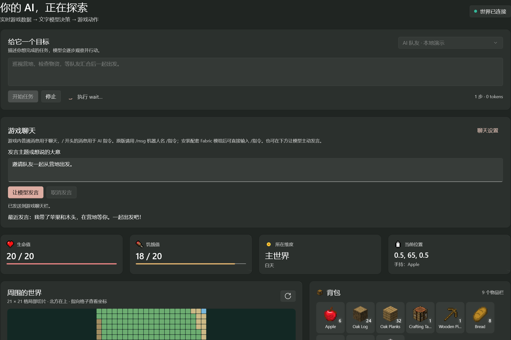
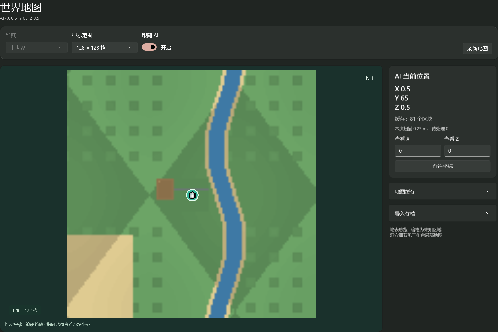
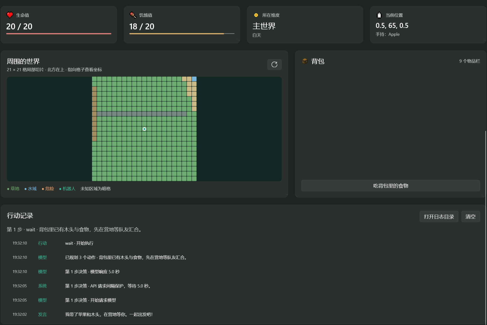
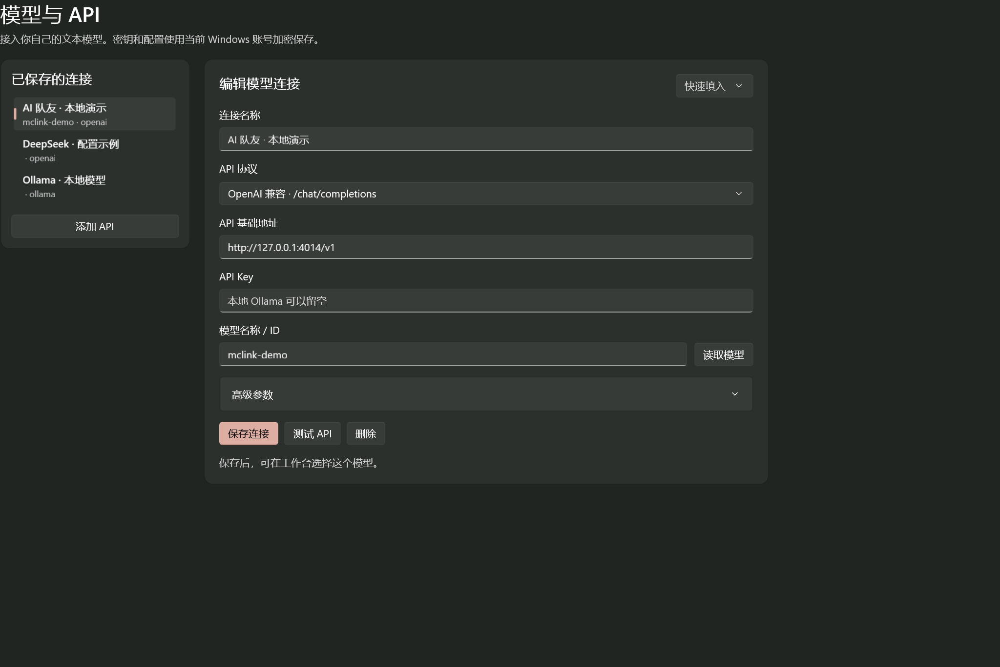

# MCLink

**邀请一个会干活、会聊天的 AI 队友，加入你的 Minecraft 世界。**

「你去砍点木头，我找地方盖房子。」

MCLink 让大模型以独立玩家的身份进入 Minecraft Java 版。给它一个目标，它会观察周围环境与背包、规划行动，再去移动、采集或合成；你也可以直接在游戏里和它聊天。一个人开荒时，多一个一起探索的伙伴。

**[下载 Windows 版](https://github.com/azaleakita/MCLink/releases/latest) · [快速上手](#使用) · [反馈问题 / 分享想法](https://github.com/azaleakita/MCLink/issues)**

适用于 **Windows 11 x64 · Minecraft Java 版**。发行包完整解压即可运行，模型 API 需要自行配置。

## 和 AI 一起做什么？

- **一起干活**：用中文布置目标，让它寻路、采集、制作物品、整理容器，或跟随队友。
- **随时聊天**：任务期间或空闲时都能回应游戏聊天，也能按你的话题主动发言。
- **看见它的进展**：生命值、背包、附近地形和行动记录集中在工作台；世界地图支持查看路线、保存缓存和导入存档。
- **选择自己的模型**：支持 OpenAI 兼容接口、Anthropic 和本地 Ollama，多组连接随时切换。
- **连续行动，控制调用频率**：每轮可执行多个动作，遇到可恢复的失败会重新规划；请求间隔和限流退避可减少密集调用。

欢迎在 Issues 分享有趣的任务、遇到的问题，或者你希望这个队友学会的新本领。实际完成效果取决于模型能力、服务器规则和游戏环境。

## 程序截图

以下为 **v0.5.0 真实程序界面**，采用本地演示地形、背包与模型响应。

**工作台 · 给它一个目标，看看它在做什么**



**世界地图 · 地形、坐标与探索路线，一眼看清**



<details>
<summary>再看看背包和模型配置</summary>

**背包与行动记录**



**模型与 API · 云端服务或本地模型都能接入**



</details>

程序使用 **WinUI 3 原生界面**，通过 Minecraft 协议获取世界状态，由代码执行寻路与游戏动作；普通文本模型即可参与，无需识图。

## 启动

发行下载：[GitHub Releases](https://github.com/azaleakita/MCLink/releases)。下载 `MCLink-版本-win-x64.zip`，完整解压后运行 `MCLink/MCLink.App.exe`；同页提供 SHA-256 校验文件。

已编译版本：解压便携包后双击 `MCLink/MCLink.App.exe`。在源码目录中可双击 `dist/MCLink/MCLink.App.exe`，或根目录 `run.cmd`。整个 `MCLink` 文件夹必须一起保留，它包含 .NET、Windows App SDK、Node.js 和桥接依赖。

自行构建：Windows 11 x64、Node.js 22+、可访问 NuGet/npm/微软下载站的网络。双击 `build.cmd`，或运行：

```powershell
.\build.ps1 -Run
```

脚本在缺少 .NET 8 SDK 时下载官方 SDK 到项目 `.tools`，使用 `npm ci` 安装锁定依赖、运行桥接测试，并发布到 `dist/MCLink`。生成版本无需再单独安装 Node、.NET 或 Windows App Runtime。不支持基岩版、macOS 或 Linux GUI。

## 使用

1. **模型与 API**：填写连接名称、协议、基础地址和 API Key，点击「读取模型」选择服务提供的模型，或手动填写模型 ID；测试后保存。快捷配置只填协议和地址，不固定指定模型。读取列表无需先填写模型名称；切换连接或修改地址、协议、密钥、请求头后需重新读取列表。可添加多个连接并在工作台切换。额外请求头使用 JSON，例如 `{"X-Project":"example"}`。
2. **游戏连接**：填写服务器 IP、端口、玩家名和登录方式；版本留空自动探测。支持离线服务器和 Microsoft 正版账号的浏览器设备码登录。
3. **工作台**：选择已保存的模型，填写目标并开始。先用短任务，例如「采集 4 个 oak_log，然后制作 crafting_table」。地图、背包和日志均来自真实协议状态。
4. **世界地图**：查看 AI 坐标与路线，拖动平移、滚轮缩放，支持 64–512 格范围。地图自动保存，下次可离线载入；也能导入本地存档中已经生成的地形。
5. **运行设置**：可调整最大动作步数、每批动作数（默认 4，范围 1–8）、批次间隔、低生命停止阈值、自动进食、聊天风格与游玩补充提示词、浅色/深色主题，以及自定义图标目录。

本地单人世界：Minecraft → Esc → 对局域网开放；主机 `localhost`，端口填写聊天栏显示的临时端口。使用不同的离线玩家名；要求正版验证时使用拥有 Java 版的 Microsoft 账号。服务器可能不允许同一正版账号同时登录机器人和游戏客户端。

## 游戏聊天与自定义提示词

连接世界并在工作台选择模型后，玩家可以直接在游戏聊天栏与 AI 交流，**不需要先开始任务**。玩家消息不以 `/` 开头时仅用于普通聊天，即使内容是「帮我砍木头」也不会启动或替换游戏任务；收到以 `/` 开头的消息时，程序把去掉 `/` 后的内容作为 AI 任务，取消旧任务和动作，再执行新指令。`/停止`、`/stop`、`/cancel` 立即停止，无需等待模型。

**原版 Minecraft 会把 `/文字` 交给服务器作为命令，其他玩家包括机器人无法直接接收。** 单人局域网 / 原版服务器无需安装模组时，请用 `/msg MCLinkBot /采集4个橡木` 给 AI 下指令；停止用 `/msg MCLinkBot /停止`。`MCLinkBot` 替换为机器人实际玩家名。普通聊天可直接发送，也可 `/msg MCLinkBot 你好` 私聊；AI 回复发到公共聊天栏。

需要直接输入 `/采集4个橡木` 时，使用随程序提供的 **Java 1.21.11 Fabric 客户端模组**。在启动器安装 Fabric 后，将 `dist/MCLink/client-mod` 的两个 JAR 放入该实例的 `mods` 文件夹。机器人默认名为 `MCLinkBot`，可用 `/mclink bot 实际机器人名` 修改；用 `/mc 原版命令` 保留原版命令入口，或 `/mclink off` 关闭转发。完整步骤见 [客户端模组说明](client-mod/README.md)。无需服务端插件。

也可在工作台「游戏聊天」中填写话题或想说的大意，点击「让模型发言」。程序把真实坐标、背包、附近环境和最近玩家聊天作为文字上下文发送给所选 API；模型生成一句普通聊天，以机器人玩家的身份通过 Minecraft 协议发到游戏聊天栏。单独发言和自动回复可以与移动等动作同时进行，点击「取消发言」会终止生成，迟到的回复不会发到游戏中。

默认提示词鼓励简短中文口语、自然队友交流，例如「我去砍点木头，你先找地方盖房子」。避免标题、步骤汇报、JSON 和重复问候；只描述有依据的游戏事实。实际风格仍取决于所选模型。

在「运行设置 → 聊天与自定义提示词」可编辑并保存：

- **允许模型在游戏内发言**：关闭后，下次任务及单独发言均不能发送聊天。
- **自动回应玩家聊天（包括空闲时）**：默认开启。独立回复流程接收最近两分钟内最多 8 条待回复的玩家消息，空闲和任务运行期间均可回应，排除机器人自己的回声。发言间隔内的新消息等待后回复；模型推理时到达的消息保留到下一次回复。普通聊天不会改变任务，关闭后仍可接收 `/` AI 指令，以及按明确任务要求发言。
- **发言间隔**：默认 8 秒，可设 3–120 秒。自动任务和单独发言共用间隔；一分钟内不会重复发送相同文本。每条最多 100 字、单行，不允许发送以 `/` 开头的命令。
- **聊天风格提示词**：可自定义口吻、称呼、语言、长短等，最多 4000 字；留空使用默认值。「恢复默认聊天提示词」只填回默认聊天风格，点击保存后生效。
- **游玩补充提示词**：可填写习惯和协作要求，例如「优先帮队友，不要拆别人建筑，发现村庄时告诉大家」，最多 4000 字。

保存后的设置立即更新游戏聊天流程；提示词用于**下次任务及下次发言**，不会改写已经进行中的任务。切换模型、停止、死亡和断线会取消尚未发出的回复；后续新消息仍可开启新回复。设置随 API 配置使用 Windows 当前账号加密保存，重启后恢复。自动回复先合并 400 毫秒内连续到来的消息；通常每次单独发言或自动回复调用一次模型 API，临时网络错误、HTTP 408、429 或 5xx 最多额外重试两次，可能产生额外服务商费用。

普通聊天只要求模型生成一句文本，同时兼容旧版 `chat` JSON 回复；不会把聊天回复中的其他动作执行成任务。完整的 `<think>…</think>` 思考内容会去掉，未结束的思考、过长回复、换行和 `/` 命令会拒绝发送。

## 世界地图与存档导入

地图随窗口大小调整。宽窗口将坐标、缓存和导入工具放在右侧独立滚动栏；窄窗口点击右上角「地图工具」进入工具页，点击「返回地图」切回地形。工具栏会自动换行，地图保持比例并限制在自身视口内。

世界地图直接扫描服务器发送的已生成区块，每个区块仅缓存 16 × 16 个地表方块和高度，使用 gzip 保存；内存最多保留 2,048 个地表摘要。读取分批让出执行时间，磁盘读取并发上限为 16。附近方块变化会触发更新，地图每 3 秒刷新，坐标随游戏观察更新。

采用区块缓存而非仅凭种子重新生成：它能保留玩家建筑、挖掘和版本生成差异，也不需要在客户端重复执行完整地形生成。导入时会读取并显示 `level.dat` 的种子，但不使用种子预测未生成区域。本次合成地形性能测量见 [VERIFICATION.md](VERIFICATION.md)，实际耗时随地形、机器和磁盘变化。

1. 本地单人世界开放局域网时，端口可能变化；先展开「地图缓存」，填写固定的「世界标识」，再连接，避免同一个存档分散为多个缓存。不同存档应使用不同标识。
2. 离线查看：在「地图缓存」中填写相同标识，点击「载入此世界缓存」。默认按服务器地址和端口区分世界；主世界、下界、末地独立保存。
3. 导入：展开「导入存档」，选择 `.minecraft/saves/存档名` 或其中的 `region` 目录，设置地图中心与导入半径（32–1,024 格），点击「开始导入」。完整存档会从 `level.dat` 自动识别版本；直接选择 `region` 时需填写版本。
4. 导入在独立后台线程运行，只以只读方式打开源文件；生成的摘要写入 MCLink 自己的缓存。在线时以当前加载的服务器地形为准。可以停止导入，已导入的区块保留。

支持常见 Anvil `.mca` 的 gzip、zlib、未压缩区块；外部 `.mcc` 区块、LZ4 压缩和模组自定义维度尚未适配，无法读取的区块会计入错误数量。实时游戏存档可能正在改写文件；导入失败时可使用关闭世界后的存档或副本重试。缓存保存在 `%LOCALAPPDATA%\MCLink\maps`，不读取游戏画面。离线位置是上次记录的位置。

## 图标

内置 **1,448 个物品 / 方块 SVG** 和 **16 个界面 SVG**，来自你提供的 [MC Icons / CC Leaf](https://mcicons.ccleaf.com/)（现跳转 CC Vaults）。网站原素材是 PNG，本项目将同色像素合并成 SVG 路径；复杂高清素材按界面的 64 像素显示尺寸精简。背包、导航、生命和饥饿值、地图玩家标记均使用图标。

网站目录未匹配到的 60 个注册名使用通用图标；模组物品可能也需要自行添加。完整来源、缺失名称见 `Assets/icon-manifest.json`，版权与来源见 [ASSET-SOURCES.md](ASSET-SOURCES.md)。

在「运行设置 → 导入图标目录」选择文件夹。物品按英文注册名命名，例如 `apple.svg`、`diamond_pickaxe.png`；可直接放在目录下，或放在 `ItemIcons` 子目录。界面图标放在 `UI` 子目录，例如 `health.svg`、`food.svg`、`world_map.svg`、`player.svg`。缺少的文件自动回退内置图标。「恢复内置图标」可随时撤销。配置记录目录位置，请保留该目录。

素材已随程序打包，启动和显示时不需要访问图标网站。重新获取素材可在源码根目录运行 `node scripts/download-icons.mjs`；需要先安装 bridge 依赖。脚本只读取公开的物品、方块、武器和选定界面素材，生成矢量文件和逐项来源清单。

## API 协议

| 协议 | 基础地址示例 | 说明 |
| --- | --- | --- |
| OpenAI 兼容 | `https://api.deepseek.com/v1` | 请求 `/chat/completions`，支持自建代理及兼容服务 |
| Anthropic | `https://api.anthropic.com/v1` | 请求 `/messages`，使用 `x-api-key` |
| Ollama | `http://localhost:11434` | 本地 `/api/chat`，可不填密钥 |

模型名称以服务实际提供的为准。地址也可以填写完整生成接口路径。任务决策使用文本 JSON 提示词，普通聊天使用自然文本，不要求供应商支持视觉、函数调用或 `response_format`。当前使用非流式响应；接口要支持相应协议的标准响应结构。不能直接接入任意结构的非兼容 API，需要修改 `bridge/src/api.mjs` 增加适配。决策解析兼容完整思考标签、代码块和说明文字包裹的单个 JSON 对象；多个对象、残缺 JSON 或错误参数仍拒绝执行。服务报告输出达到 token 上限时会明确提示截断。

普通文本模型每轮收到任务、真实观察、最近动作结果、剩余动作步数和本轮允许的动作数，并输出一个短计划。例如已知背包中有足够原木时：

```json
{"reason":"用现有原木制作材料和工作台","actions":[{"action":"craft","args":{"item":"oak_planks","count":2}},{"action":"craft","args":{"item":"stick","count":1}},{"action":"craft","args":{"item":"crafting_table","count":1}}]}
```

模型支持移动、搜索方块、查询配方、采集、挖掘、放置、合成、熔炼、箱子/容器存取、装备、吃东西、攻击、跟随、交互和普通聊天。寻路与游戏动作由代码执行，模型不直接操作键盘。

也兼容旧格式 `{"action":"collect","args":{"name":"oak_log","count":4}}`。批次执行期间不在每个动作之间重新调用模型或插入等待；模型仍可按需要只返回一个动作。查询结果、采集不完整、动作失败、受到伤害、计划超过 45 秒或死亡时丢弃剩余动作，根据新观察重新规划。批次中的 `done` 不能直接确认前面的操作成功，程序会先重新请求模型，要求依据当前世界确认完整目标。

在「模型与 API → 高级参数」可调整 **API 请求最短间隔**（默认 8 秒，范围 0–120 秒；Ollama 快捷配置为 0）。同一个服务地址的任务决策、自动聊天、单独发言、API 测试和读取模型列表共用串行队列，不因切换模型、API Key 或任务而绕过冷却。间隔按请求发出时间计算，实际动作和模型响应耗时已经占用的时间不会重复等待。

HTTP 429 默认从 15 秒开始指数退避，附加少量随机延迟，逐渐延长至 120 秒；服务端 `Retry-After` 指定更长时间时遵守该时间。其他临时错误从 1 秒开始退避。同一服务的后续请求也遵守冷却，并在连续成功后逐步恢复频率。排队和冷却支持停止取消，不计入单次 HTTP 请求的 90 秒超时。此行为遵循 [DeepSeek 官方限流与错误处理说明](https://api-docs.deepseek.com/zh-cn/quick_start/error_codes/)；应用无法保证服务商不再限制账号。保护范围为当前桥接进程，其他软件或另一个 MCLink 实例的调用不在该队列内。

## 数据范围与停止行为

- 世界数据仅来自服务器已经发送给机器人的区块；不会读取未加载地形。模型会通过探索加载更多区域。
- 工作台地图是机器人附近 **21 × 21 格**、当前高度上 4 格到下 8 格范围的局部切片，适用于地表和洞穴；世界地图显示已缓存和导入区块的地表。模型仍接收紧凑的局部观察，整张地图不会反复发送给 API。
- 背包物品、附近实体和资源点直接读取协议数据。容器内容只有实际打开后才可读取。
- 每次模型最多规划设置数量的动作（默认 4）；整个计划格式通过检查后逐个执行，每个动作前重新检查生命和游戏状态。结果和错误进入下一次规划，历史不重复携带完整背包快照。连续三次格式错误或五次动作失败会停止；有效计划和成功动作分别清除相应错误计数。临时 API 故障保留原任务并冷却重试，连续六轮仍不可用才停止；认证、余额等不可重试错误立即提示。API 重试不消耗动作步数。
- 停止按钮会取消正在等待的 API 请求和游戏动作，清除寻路、挖掘及移动输入。已经发送到服务器的动作无法回滚。连接断开、低生命值或步数耗尽会停止任务。
- 死亡后自动发送复活请求，取消死亡前尚未完成的模型决策和动作，等待新位置、生命值和区块加载，再根据当前背包继续尚未停止的原任务。复活期间可以停止任务；断线后不会复活或重启任务。服务器在多次请求后仍不允许复活时，程序会停止等待并提示；同一任务累计死亡 5 次会停止任务，机器人仍会复活。
- 常规动作最长 60 秒，熔炼最长 120 秒；超时后清除动作并反馈错误。低生命阈值 0 关闭低生命停止，可在死亡复活后继续任务；其他阈值仍可在死亡前停止任务。
- 挖掘先判断目标是否可见且在触及范围内，否则寻找能看见、够到方块的位置；不要求站到高处原木的同一高度。挖掘寻路最多 10 秒，拾取寻路最多 3 秒，其他单次寻路最多 30 秒。采集中途遇到不可达目标时返回已经挖掉的数量和停止原因，背包变化仍是实际拾取依据；批次达到 30 秒后不再开始下一个方块。
- 两批动作之间等待运行设置中的间隔（默认 2 秒），同批动作连续执行；下一次模型请求还受共用 API 间隔保护。日志记录计划动作数、API 请求间隔或冷却、模型响应耗时、行动耗时和批次等待；长请求或动作每 10 秒记录一次等待进度。
- 游玩效果取决于模型的规划能力、服务器规则和协议版本支持。大型模组包、自定义方块以及插件菜单没有专门适配。程序不会保证普通模型能独立通关。

## 配置与隐私

配置存于 `%LOCALAPPDATA%\MCLink\settings.bin`，整个配置（含 API Key 和自定义请求头）使用 Windows DPAPI `CurrentUser` 加密，可在同一 Windows 账号下读取。Microsoft 认证缓存由 Prismarine 认证库保存在同目录 `auth` 文件夹，切勿分享该目录。

界面保留最近 300 条行动记录，并在后台写入 `%LOCALAPPDATA%\MCLink\logs` 的 `mclink-日期-进程号-分段.log` 文件，每行包含时间、分类和消息的 JSON。工作台「打开日志目录」可直接访问，重启后仍保留，超过 14 天的旧日志会清理，单文件达到 10 MB 时换新文件。「清空」只清除界面记录。日志含游戏聊天、任务和动作结果；写入前隐藏已配置的 API Key、自定义请求头中至少 8 字符的值及当前密钥输入框内容。API 错误不会回显服务端原始响应。

使用在线 API 时，结构化游戏观察（包括附近游戏聊天）会发送给你选择的服务。密钥只交给配置的 API 服务。Ollama 本地地址可用于本地推理。

## 源码与验证

```text
src/MCLink.App/      C#、XAML WinUI 3 界面、DPAPI 配置、Node 进程管理
bridge/src/         Minecraft 接入、观察整理、模型协议适配、动作和代理循环
bridge/test/        API、取消行为、地图数据和 JSON-lines 集成测试
build.ps1           编译及便携发布脚本
client-mod/         Java 1.21.11 Fabric 客户端指令转发模组
build-client-mod.ps1 编译并打包配套模组（Java 21 JDK）
```

```powershell
cd bridge
npm ci
npm run check
npm test
```

构建和自动测试不能代替接入你自己的真实服务器与 API 后的游玩验证。首次使用请确认机器人已进入世界且 API 测试通过。

本次构建的具体验证结果见 [VERIFICATION.md](VERIFICATION.md)。开发或测试时可用 `MCLINK_DATA_DIR` 环境变量指定隔离的配置与认证缓存目录。

布局诊断默认关闭。开发时同时设置 `MCLINK_DIAGNOSTICS=1`、`MCLINK_LAYOUT_CAPTURE=绝对路径.png`，可在地图刷新后保存本程序的 XAML 界面和控件边界 JSON；`MCLINK_API_LAYOUT_CAPTURE=绝对路径.png` 用于模型页。不捕获桌面或游戏画面。`MCLINK_WINDOW_SIZE=1100x900` 可指定测试窗口的初始像素尺寸。

技术依据：[Mineflayer 官方 API](https://github.com/PrismarineJS/mineflayer/blob/master/docs/api.md)、[Pathfinder](https://github.com/PrismarineJS/mineflayer-pathfinder)、[WinUI 3 无 MSIX 分发](https://learn.microsoft.com/en-us/windows/apps/package-and-deploy/unpackage-winui-app)、[Mica 材质](https://learn.microsoft.com/en-us/windows/apps/design/style/mica)。

第三方依赖由各自许可证覆盖；Node.js 发布版本的许可文件应随便携版本保留。

## 发布与云端接手

公开源码仓库：[azaleakita/MCLink](https://github.com/azaleakita/MCLink)。新会话先阅读 [HANDOFF.md](HANDOFF.md)。Node 桥接可在 Linux 和 Windows 上开发与测试，原生界面的构建和运行需要 Windows。

GitHub Actions 在提交与 PR 时运行两种平台的桥接检查，并在 Windows 构建应用和 Fabric 模组。未来发版先同步应用 `csproj`、bridge `package.json` 与锁文件中的版本，添加 `releases/v版本.md`，提交后推送对应 `v版本` 标签；Release workflow 会验证、构建并发布 ZIP 和 SHA-256。Fabric 模组版本独立维护。

本地打包命令（Windows PowerShell）：

```powershell
.\build.ps1 -BuildClientMod
.\scripts\package-release.ps1 -RequireClientMod
```

构建支持 `-OutputDirectory`，原生设置测试支持 `-AppDirectory`，可使用独立目录避免改写正在运行的程序。打包脚本验证程序、桥接版本及必要运行时/文档，拒绝带有本地配置或凭据的目录，省略 PDB，并在 ZIP 中保留完整 `MCLink/` 根目录。同名 ZIP 已存在时应使用新的输出目录。
